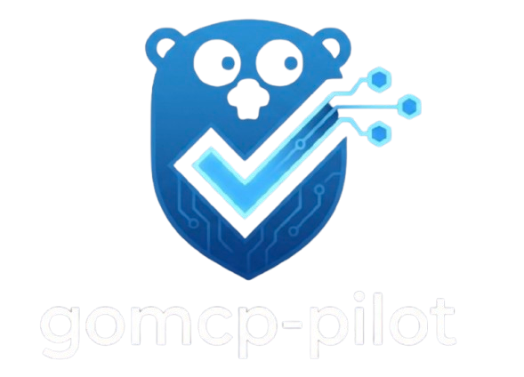
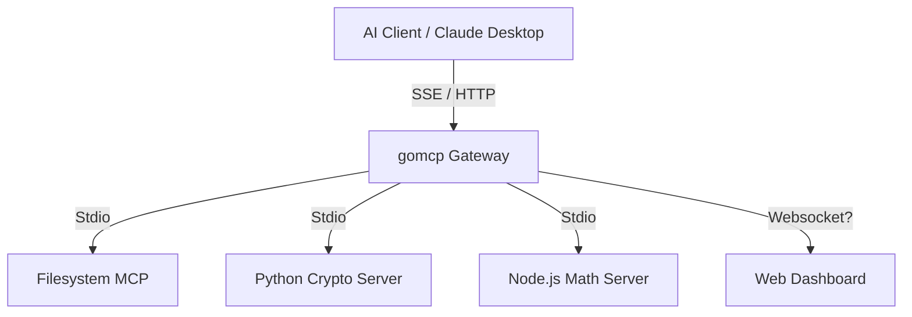

<div align="center">
  
  <h1>gomcp-pilot</h1>
  <p>
    <b>A high-performance Model Context Protocol (MCP) gateway written in Go</b>
  </p>

  [](go.mod)
  [](LICENSE)

  [ [English](doc/README_EN.md) | **中文** ] <a href="https://deepwiki.com/zuquanzhi/gomcp-pilot"></a>
</div>

**gomcp-pilot** is a high-performance Model Context Protocol (MCP) gateway written in Go. It connects large language models (LLMs) with local tools, services, and file systems.

The project is named "Pilot" to act as a guiding assistant for AI agents. While handling protocol conversion, it provides unified protocol translation, permission control, and visualization monitoring, helping developers better understand and control AI behavior.

## Core Features

*   **High-performance gateway**: Built on Go, it concurrently processes multiple upstream MCP servers.
*   **Polyglot support**: Connects to MCP servers written in any language, such as Python, Node.js, or Go (via Stdio).
*   **Full protocol support**:
    *   **Tools**: Dynamically discovers and invokes tools.
    *   **Resources**: Unifies the aggregation and reading of resources (e.g., files, system status).
    *   **SSE**: Supports the Server-Sent Events protocol, compatible with standard clients like Claude Desktop.
*   **Visualization interface**:
    *   **TUI (Terminal User Interface)**: Monitors traffic in real time, intercepts requests, and displays detailed logs.
    *   **Web Dashboard**: A modern React-based interface for browsing tool and resource lists.
*   **Secure and controllable**:
    *   Token-based authentication.
    *   Human-in-the-loop: Critical operations (e.g., file writing) can be configured to require human approval.

## Quick Start

### Prerequisites
*   Go 1.23+
*   Node.js 18+ (for the Web Dashboard)
*   Python 3.10+ (for example servers and AI clients)

### One-click Development Environment Startup

We provide a convenient control script to manage all services:

```bash
# 1. Start all services (backend + frontend) and keep them running in the background
./scripts/dev/control.sh start

# 2. View real-time logs
./scripts/dev/control.sh logs

# 3. Stop all services
./scripts/dev/control.sh stop

# 4. Enter TUI interactive mode (automatically stops background services to free up ports)
./scripts/dev/control.sh tui
```

After startup:
*   **API Gateway**: `http://localhost:8080`
*   **Web Dashboard**: `http://localhost:5173`

### Manual Build and Run

If you prefer manual operation:

```bash
# Compile
go build -o bin/gomcp ./cmd/gomcp

# Start TUI mode
./bin/gomcp start

# Start headless mode (Headless Server)
./bin/gomcp serve

# Start Web Dashboard
cd web && npm install && npm run dev
```

## Architecture



## Configuration File (`config.yaml`)

```yaml
port: 8080
auth_token: "TEST" # Simple Bearer token authentication

upstreams:
  - name: "filesystem"
    command: "./bin/gomcp"
    args: ["stdio"]
    env: []
    auto_approve: false # Requires human approval in TUI mode

  - name: "crypto-py"
    command: "python3"
    args: ["scripts/servers/crypto_server.py"]
    auto_approve: true

  - name: "math-js"
    command: "node"
    args: ["scripts/servers/math_server.js"]
    auto_approve: true
```

## Roadmap

### Phase 1: Core Foundation (Completed)
- [x] **MCP Protocol**: Full implementation of the core MCP protocol (Client & Server).
- [x] **Gateway Transport**: Support for the Stdio transport protocol, enabling stable connections to local processes.
- [x] **Polyglot Support**: Seamless compatibility with servers written in Python, Node.js, Go, and other languages.
- [x] **SSE Integration**: Implementation of Server-Sent Events, compatible with clients like Claude Desktop.

### Phase 2: Observability & Control (Completed)
- [x] **TUI Monitor**: A powerful terminal interface for real-time traffic monitoring.
- [x] **Web Dashboard**: A modern React-based management panel.
- [x] **Human-in-the-loop**: A mechanism for approving sensitive operations.
- [x] **Configuration**: Flexible YAML-based configuration management.

### Phase 3: Advanced Features (Under Development)
- [ ] **Remote Upstreams**: Support for connecting to remote MCP servers via HTTP/SSE.
- [ ] **Advanced Auth**: Integration of OAuth2 or more granular API key management.
- [ ] **Plugin System**: Support for custom middleware plugins.
- [ ] **Docker Support**: Provision of standard Docker images and Kubernetes deployment manifests.
- [ ] **WebSockets**: Full-duplex communication support for enhanced real-time performance.
- [ ] **Metrics**: Metrics monitoring and alerting.
- [ ] **RAG**: Semantic resource discovery and search.

## API Reference

### Core Endpoints
*   `GET /sse`: MCP SSE endpoint (clients connect here)
*   `POST /mcp/message`: JSON-RPC message interaction endpoint

### Legacy / Debug Endpoints
*   `GET /tools/list?upstream=name`
*   `POST /tools/call`
*   `GET /resources/list?upstream=name`
*   `GET /resources/read?uri=...`

All endpoints require the Header: `Authorization: Bearer <token>`
